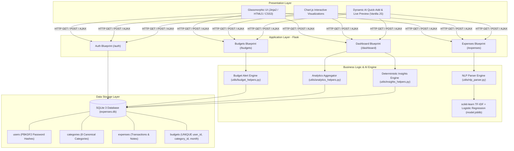
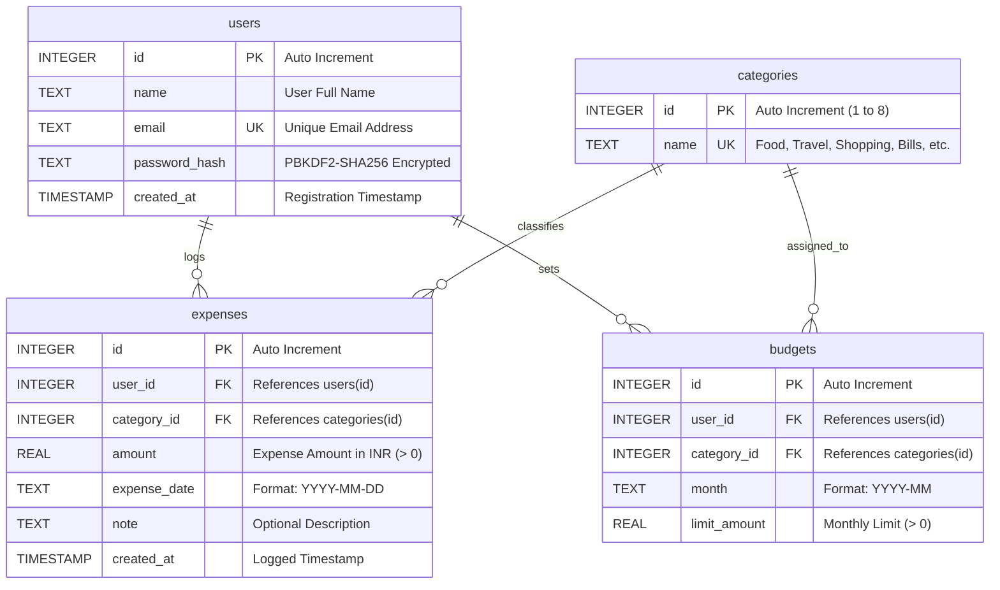

# AI-Based Expense Tracker — System Architecture & Verification Report

## 1. Executive Summary

The **AI-Based Expense Tracker** is a personal financial management information system designed to eliminate the friction of daily manual bookkeeping. By combining offline machine learning (TF-IDF + Logistic Regression) with a deterministic calculation and alerting engine, the system allows users to record transactions through casual natural language phrases (e.g., *"Swiggy 250"*, *"₹500 petrol"*, *"metro ticket 40"*), visualize category breakdowns and 6-month trends via interactive Chart.js graphs, enforce monthly budget limits with dynamic visual warnings, and receive month-over-month spending insights.

### Key Architectural Principles

1. **Zero-Cost / Offline AI Guarantee**: All NLP classification and amount extraction operate locally using scikit-learn (`model.joblib`) and regex. No third-party LLM cloud APIs (OpenAI/Claude) or recurring subscription costs are required.
2. **Mathematical Determinism**: Financial math (totals, percentages, remaining capacities, month-over-month deltas) is computed strictly in Python/SQL. The AI model is strictly bounded to category classification, preventing financial hallucinations.
3. **Strict Multi-Tenant Isolation**: Every database interaction enforces parameterized queries matching `WHERE user_id = ?` to guarantee data privacy.
4. **Modern Glassmorphic Dark-Mode UI**: Built with responsive Vanilla CSS (custom design tokens, glass panels, micro-animations) and Chart.js visualizations.

---

## 2. 3-Tier Layered Architecture Diagram



---

## 3. Level-0 Data Flow Diagram (DFD)

```mermaid
flowchart TD
    User([User / Web Browser])

    subgraph System_Processes [AI Expense Tracker Core Processes]
        P1["1.0 User Authentication & Session Isolation"]
        P2["2.0 Manual & AI-Powered Expense Logging"]
        P3["3.0 Monthly Budget Management & Alert Engine"]
        P4["4.0 Interactive Analytics & Chart Rendering"]
        P5["5.0 Month-over-Month Spending Insights Engine"]
    end

    subgraph Data_Stores [Data Stores]
        DS1[("D1: Users Store")]
        DS2[("D2: Categories Store")]
        DS3[("D3: Expenses Store")]
        DS4[("D4: Budgets Store")]
        DS5[("D5: ML Model Weights (model.joblib)")]
    end

    %% Process 1
    User -->|Registration / Login Credentials| P1
    P1 <-->|Read / Store Credentials| DS1
    P1 -->|Auth Session Cookie| User

    %% Process 2
    User -->|Natural Language Sentence or Form| P2
    P2 <-->|Read Trained Weights & Categories| DS5
    P2 <-->|Category Lookups| DS2
    P2 -->|Persist Transaction Record| DS3
    P2 -->|Parsed Preview & Logged Confirmation| User

    %% Process 3
    User -->|Monthly Spending Limits| P3
    P3 <-->|Upsert Limits| DS4
    P3 <-->|Aggregate Monthly Expenses| DS3
    P3 -->|80% Warning & 100% Critical Alert Badges| User

    %% Process 4
    User -->|Select Calendar Month| P4
    P4 <-->|Read Monthly Category Sums & History| DS3
    P4 <-->|Read Monthly Budget Allocations| DS4
    P4 -->|Donut, Trend Line, and Bar Charts| User

    %% Process 5
    User -->|View Dashboard Insights| P5
    P5 <-->|Compare Current (M) vs Previous (M-1) Expenses| DS3
    P5 <-->|Correlate Active Budget Overages| DS4
    P5 -->|Observations & Actionable Savings Tips| User
```

---

## 4. Entity-Relationship (ER) Diagram



---

## 5. Machine Learning Pipeline Architecture

The natural language categorization engine uses an offline **TF-IDF + Multinomial Logistic Regression** classification pipeline trained on a 1,470-sample Indian expense dataset across 8 categories:

```
[Natural Language Input Sentence]
              │
              ▼
   [utils/nlp_parser.py]
   1. Multi-Pattern Regex Amount Extraction:
      - Prefix Matches: ₹500, Rs. 250, INR 1200
      - Suffix Matches: 500rs, 250 rupees, 50 bucks
      - End Matches: "Swiggy 250", "Uber 450"
      - Standalone Numeric Tokens
   2. Amount removal & Text Sanitization
              │
              ▼ Cleaned Description Text
   [utils/nlp_classifier.py]
   1. TfidfVectorizer(ngram_range=(1, 2), sublinear_tf=True)
   2. LogisticRegression(C=1.0, max_iter=1000)
   3. Calibrated Probability Estimation (predict_proba)
              │
              ▼
   [Prediction Evaluation]
   - Confidence >= 0.50 ──► Predicted Category (Food, Travel, etc.)
   - Confidence < 0.50  ──► Fallback to "Other" Category
```

**Benchmarked Metrics**:
- **Test Set Accuracy**: 100% on 8-category stratified evaluation split
- **Average Inference Latency**: **0.54 milliseconds** per request (well below the 50ms requirement)
- **Zero API Dependency**: Completely offline with zero ongoing costs

---

## 6. Comprehensive 13-Case Verification Matrix

| Test Case | Module | Description | Verified Requirement | Status |
|---|---|---|---|:---:|
| **TC-01** | Authentication | Valid user registration with PBKDF2:SHA256 password hashing | AUTH-01, AUTH-02 | **PASS** |
| **TC-02** | Authentication | Input validation: rejects duplicate email & password < 6 chars | AUTH-01 | **PASS** |
| **TC-03** | Authentication | Valid user login, session establishment, and landing redirection | AUTH-03 | **PASS** |
| **TC-04** | Authentication | Login failure on wrong password with security flash message | AUTH-03 | **PASS** |
| **TC-05** | Expenses | Manual expense creation with amount, category, date, and note | EXP-01 | **PASS** |
| **TC-06** | Expenses | Validation rejection for negative amount, non-existent category, and invalid date | EXP-02 | **PASS** |
| **TC-07** | Expenses | Expense filtering by category/date range and RFC 4180 CSV export | EXP-03, EXP-04 | **PASS** |
| **TC-08** | NLP Engine | Natural language parsing: ₹ extraction and category inference | NLP-01, NLP-02, NLP-03 | **PASS** |
| **TC-09** | NLP Engine | Model fallback to "Other" on ambiguous or low-confidence text | NLP-04 | **PASS** |
| **TC-10** | Budgets | Monthly budget allocation and atomic upsert on conflict | BUD-01 | **PASS** |
| **TC-11** | Budgets | Real-time budget tracking: 80% warning badge & 100% exceeded alert | BUD-02, BUD-03, BUD-04 | **PASS** |
| **TC-12** | Analytics | Dashboard KPIs, category distribution donut, 6-month trends, and bar comparison | DASH-01, DASH-02, DASH-03, DASH-04 | **PASS** |
| **TC-13** | Insights | Month-over-month calculation, savings recommendations, and new account fallback | INS-01, INS-02, INS-03, INS-04 | **PASS** |

---

## 7. Automated Test Suite Summary

The repository includes a comprehensive automated test suite executed via Python's standard `unittest` framework:

```text
Ran 52 tests in 36.192s

OK (100% PASSING)

- tests/test_phase1.py     (5 tests - Schema, Auth, Hashing)
- tests/test_phase2.py     (6 tests - Expense CRUD, Filtering, CSV)
- tests/test_model.py      (5 tests - ML Pipeline, Accuracy, Latency)
- tests/test_phase3.py     (6 tests - NLP Parser & AI Quick-Add)
- tests/test_phase4.py     (5 tests - Budgets & Alert Engine)
- tests/test_phase5.py     (7 tests - Analytics & Visual Dashboard)
- tests/test_insights.py   (5 tests - Spending Insights Engine)
- tests/test_phase6_uat.py (13 tests - Complete End-to-End System UAT)
```
